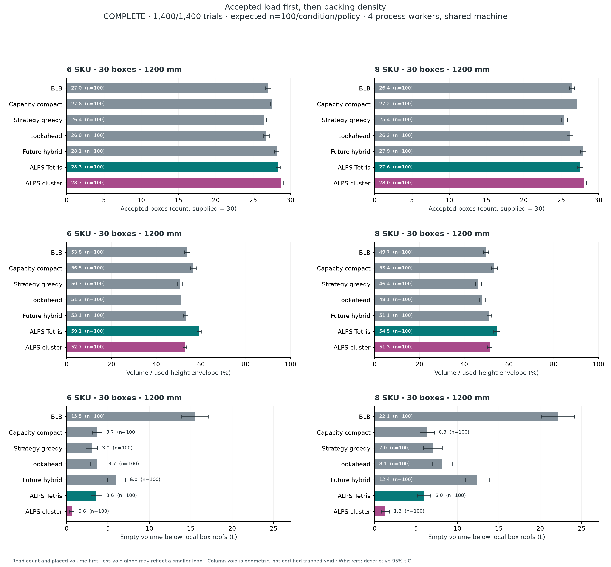

# ALPS Tetris 비교 결과 · 2026-10-10

**100개 입고 순서 × 2조건 × 7정책 = 1,400회 완료. 실제 계산 804.41초(13분 24초). 독립 원자료 검산 1,400/1,400회, 오류 0건.** MCTS는 제외했다. 기본 적재량과 3차원 밀도를 먼저 판단하고 SKU 군집은 추가 효과로 읽는다.

ALPS Tetris는 두 조건 모두 비교한 7정책 중 **평균 사용 높이 기준 밀도가 가장 높았다**. Compact보다 평균 적재 수량·부피 수용률도 높았다. 다만 8 SKU의 부피 수용률 차이는 다중비교 보정 후 불확실하고, 모든 정책보다 우수하거나 최적이라는 근거는 없다. 군집 정책은 수량·SKU 접촉·국소 내부 공극에서 유리하지만 더 높게 쌓여 사용 높이 기준 밀도가 낮아진다. 따라서 SKU 점수만으로 기본 적재 성능의 우위를 주장하지 않는다.

## 동일 입력의 전체 100회 평균

팔레트 1,200 × 1,000mm, 허용 높이 1,200mm, 입력 30개. 각 조건의 재고 구성은 고정하고 **서로 다른 SKU 입고 순서 100개**를 난수로 생성·중복 검사했다. 1,000개 실행이 아니다. 같은 조건·시드의 7정책은 동일한 입력을 받는다. 두 조건의 SKU 구성과 총 부피가 달라 조건 간 절대 적재율을 직접 우열 비교하지 않는다. 공급 재고 부피 자체가 허용 팔레트 공간의 약 54%이므로 높이 상한 기준 적재율이 50% 안팎이라는 이유만으로 공간 활용이 나쁘다고 단정하지 않는다.

| SKU | 정책 | 적재 수량 /30 | 공급 부피 수용률 % | 사용 높이 밀도 % | 사용 높이 mm | 국소 내부 공극 L | 동일 SKU 접촉 % | 판단 P95 ms | 참고 점수 /100 |
|---|---|---:|---:|---:|---:|---:|---:|---:|---:|
| 6 | BLB | 27.01 | 85.26 | 53.80 | 1028.2 | 15.50 | 30.69 | 15.3 | 78.32 |
| 6 | Compact | 27.59 | 87.77 | 56.54 | 1008.6 | 3.65 | 30.28 | 31.5 | 80.41 |
| 6 | Greedy | 26.41 | 82.09 | 50.67 | 1050.5 | 3.02 | 42.80 | 32.0 | 76.99 |
| 6 | Lookahead | 26.78 | 83.99 | 51.26 | 1062.1 | 3.69 | 42.36 | 151.8 | 78.11 |
| 6 | Future Hybrid | 28.15 | 91.04 | 53.08 | 1113.0 | 6.01 | 42.72 | 645.1 | 82.72 |
| 6 | **ALPS Tetris** | **28.32** | **91.36** | **59.14** | **1001.8** | **3.58** | 35.46 | 249.0 | 83.63 |
| 6 | ALPS cluster | 28.73 | 93.55 | 52.73 | 1148.2 | 0.59 | 54.85 | 80.2 | 87.41 |
| 8 | BLB | 26.43 | 83.38 | 49.69 | 1087.9 | 22.12 | 23.79 | 15.9 | 76.02 |
| 8 | Compact | 27.16 | 86.09 | 53.43 | 1048.2 | 6.32 | 23.85 | 31.6 | 78.34 |
| 8 | Greedy | 25.40 | 78.36 | 46.35 | 1096.6 | 7.00 | 35.03 | 33.0 | 73.40 |
| 8 | Lookahead | 26.16 | 81.48 | 48.10 | 1097.4 | 8.14 | 34.33 | 170.8 | 75.24 |
| 8 | Future Hybrid | 27.94 | 90.67 | 51.13 | 1146.5 | 12.39 | 34.90 | 812.2 | 81.26 |
| 8 | **ALPS Tetris** | **27.55** | **88.19** | **54.52** | **1052.3** | **5.95** | 28.70 | 248.0 | 80.66 |
| 8 | ALPS cluster | 28.00 | 89.97 | 51.33 | 1132.9 | 1.27 | 47.82 | 86.4 | 84.08 |

공급 부피 수용률은 `적재 부피 / 공급 부피`, 사용 높이 밀도는 `적재 부피 / (팔레트 면적 × 최고 사용 높이)`다. 표는 각 실행의 지표를 평균했다. 국소 내부 공극은 각 XY 열의 상자 지붕 아래 빈 공간이며, 전체 미사용 공간이나 회수 불가능한 공극 인증값이 아니다. 덜 담아도 공극이 작을 수 있으므로 수량·부피와 함께 판단한다. 바닥 접촉률도 3차원 밀도와 다르다.

참고 점수는 평가 전에 고정한 `수용률60 + 바닥15 + 동일SKU접촉15 + 기한준수10`이다. 기본 적재량·밀도 손실을 다른 점수로 상쇄해 채택하지 않는다. 이 점수는 사용자 요청의 보조 비교값이며 채택 순위가 아니다. 가중치는 결과를 보고 수정하지 않았다.



## 채택 판단과 불확실성

주평가 변수는 공급 부피 수용률이다. 사전 지정한 Tetris 대 6개 정책 × 2조건의 12비교에 대해 대응 표본 및 Bonferroni 동시 95% 신뢰구간을 적용했다. 실용적 우월성 기준은 +2%p다.

| Tetris − Compact | 평균 차이 | 보정 95% 신뢰구간 | 해석 |
|---|---:|---:|---|
| 6 SKU | +3.60%p | [+0.68, +6.51]%p | 양의 차이 근거가 있지만 최소 +2%p 개선까지 입증한 것은 아님 |
| 8 SKU | +2.11%p | [−0.70, +4.91]%p | 보정 후 우월성 미확정 |

사용 높이 밀도는 유망한 **기술통계 결과**이며 사전 주검정 가족에 포함되지 않았다. Cluster와 Compact의 우월성·비열등성도 별도의 사전 검정 없이 확정하지 않는다. 8 SKU에서는 Future Hybrid의 평균 부피 수용률이 Tetris보다 높았지만 사용 높이 밀도·내부 공극·판단 지연은 불리했다. 최종 선택은 물량, 높이 효율, 군집, 계산 비용의 실제 요구에 달려 있다.

**권고:** ALPS Tetris는 기본 밀도를 중시하는 채택 후보로 유지할 근거가 있다. 군집 정책은 적재량과 군집을 함께 중시할 때 검토하되 낮아진 사용 높이 밀도를 공개한다. 현재 결과로 단일 최적 알고리즘을 선언하지 않는다.

## 시뮬레이터에 추가한 관측 우수 사례

`#benchmark-best`의 **관측 우수 사례** 화면에 원자료를 그대로 재생하는 두 비교를 추가했다. 기존 개발 시연·전체 100회 평균은 보존했다. 성능을 다시 계산해 더 좋은 값으로 대체하지 않았다.

- **전량 적재·밀도 사례:** 전량 30개를 적재한 Tetris 실행 39개 중 사용 높이 밀도 최대, 동률은 내부 공극·사용 높이·시드 순. 8 SKU, seed `460100063`. 동일 입고의 Compact **27개·676.276L·56.93%·990mm** → Tetris **30개·773.526L·69.31%·930mm**. 내부 공극은 **4.460→5.952L로 증가**한 점도 표시한다.
- **관측 개선 폭 사례:** 같은 입고의 Compact 대비 적재 수량과 사용 높이 밀도가 악화되지 않는 쌍에서 부피 수용률 개선 최대. 6 SKU, seed `460000000`. Compact **22개·469.280L·36.89%** → Tetris **29개·732.880L·55.52%**.

이 선택 규칙은 **결과를 확인한 뒤 시연 목적으로 적용**했다. 선택 사례는 대표 평균, 새로운 독립 검증, 일반적 개선 폭이 아니다. 원자료 경로·시드·입력 지문·SHA256·선택 규칙과 전체 평균 링크를 화면과 [색인](../../public/benchmark-best/index.json)에 기록했다.

## 실행·검증·재현

- 4개 프로세스, 25개 입고 순서 단위의 8개 작업 조각. 정규 계획 Worker 경로로 42,000개 판단 완료. 전체 오류·취소·제약 위반·기한 실패 0건.
- 판단 P95는 조건·정책별 실제 `decisionMs` 3,000개를 합친 분위수다. 4개 프로세스가 공유한 장비의 측정이며 CPU 경합은 시간 제한 탐색의 품질에도 영향을 줄 수 있다. 실제 로봇 처리 시간으로 일반화하지 않는다.
- [동결 정보·입력](evaluation-v2/freeze.json), [실행 계획](evaluation-v2/pool-plan.json), [원자료·진행 결과](evaluation-v2/progress.json), [독립 감사](evaluation-v2/audit/summary.md), [전체 대응 비교](evaluation-v2/audit/paired-effects.csv), [점수·밀도 상세](score-summary.json), [Claude Opus 5.5 API 검토](CLAUDE-REVIEW.md).
- 원자료에서 수량·부피·경계·겹침·동일 입력·중복 입고 순서·소스 해시·판단 수와 기한을 독립 검산했다. 실제 포장 강도, 로봇 IK, 그리퍼·전신 충돌, 운송 안정성의 실물 검증은 포함하지 않는다.
- 합성 2종 재고의 입고 순서 민감도 실험이다. 다른 박스 치수·재고 비율·오차·실물 입력에 대한 일반화는 후속 검증이 필요하다.

```sh
python3 scripts/benchmark-1000-audit.py --root docs/benchmark-1000/evaluation-v2
python3 scripts/select-benchmark-best.py
npm test
npm run build
```

과거 개발 실험 133회·군집 선정/확인 160회와 중단된 pilot-v1은 본 1,400회 평가와 합산하지 않았다. 첫 50회 비교는 동결 순서의 앞부분만 사용한 중간 기술통계이며 최종 100회 결과를 대신하지 않는다.
